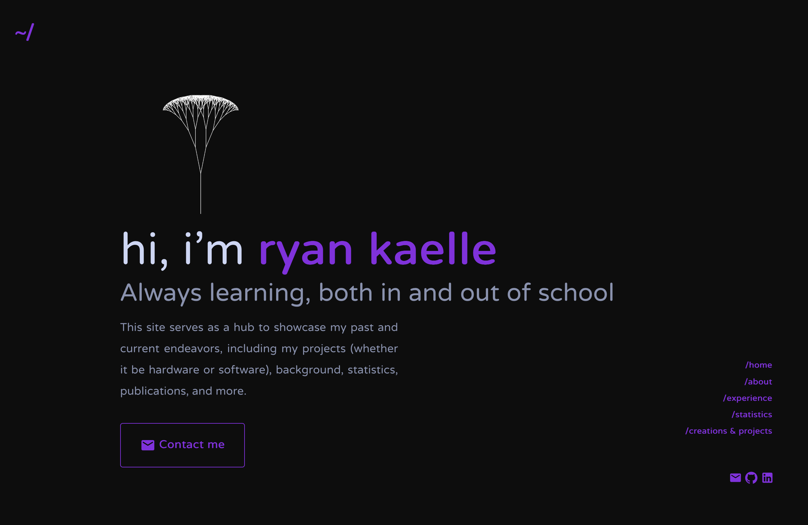

# Ryan Kaelle — Portfolio

Source for [rkaelle.com](https://www.rkaelle.com), built with Next.js, React, TypeScript, and Tailwind CSS. Includes engineering experience, project case studies, a photo gallery, and Daily News subscription management.



## Local development

Use Node.js 24, matching `.nvmrc` and `package.json`:

```sh
nvm use
npm ci
cp .env.example .env.local
npm run dev
```

Fill `.env.local` with your Firebase web-app configuration. Existing local `.env` files also work and are ignored by Git. Never put service-account credentials, email passwords, or admin tokens in this application or any `NEXT_PUBLIC_*` variable. Firebase browser configuration is intentionally public; backend rules and IAM control access.

Edit experience in `app/components/JobList.tsx` and projects in `app/lib/projects.ts`. Projects with descriptions receive static detail pages and sitemap entries. Everything under `public/` is publicly accessible.

## Vercel deployment

The connected `rkaelle/portfolio` GitHub repository deploys to the Vercel `portfolio` project. Use the Next.js framework preset, repository root, and standard `npm run build` command. Keep output-directory detection automatic. The committed npm lockfile pins dependency resolution; `engines.node` selects Node.js 24 on the next deployment.

Configure the Firebase variables listed in `.env.example` in Vercel's Environment Variables settings. `NEXT_PUBLIC_*` values are embedded during the build, so changes require a new deployment. Use a separate Firebase project for preview/development environments when testing writes; do not copy administrative credentials into preview builds.

Production deployments normally follow pushes to the project's configured production branch. No second deployment workflow or deployment token is needed in this repository. A local CLI upload uses `.vercelignore` to exclude environment files, credentials, logs, audit reports, tests, and local tooling. `.gitignore` controls what enters Git; neither file erases existing Git history or makes files in `public/` private.

Firebase rules deploy separately from Vercel. Review [SECURITY.md](SECURITY.md) before changing them. The gallery remains read-only for browser clients, and Daily News supports validated signup and verified-email unsubscribe.

If using the Vercel CLI, update an older installation with `npm i -g vercel@latest` before linking or deploying. Keep generated `.vercel/` metadata local.

## Build and verification

```sh
npm run test:security
npm run build
npm start
```

In another terminal:

```sh
npm run test:seo
npm run test:security:http
```

Use `SEO_BASE_URL` for a different local port. To verify the deployed Firebase project's anonymous read restrictions without accessing existing records:

```sh
npm run audit:firebase
```

The audit script loads `.env` and then `.env.local` (if present), with `.env.local` taking precedence. It only queries random nonexistent IDs and makes no writes. All probes must return HTTP 403; unexpected responses cause a nonzero exit. Detailed local audit reports are ignored by Git.
